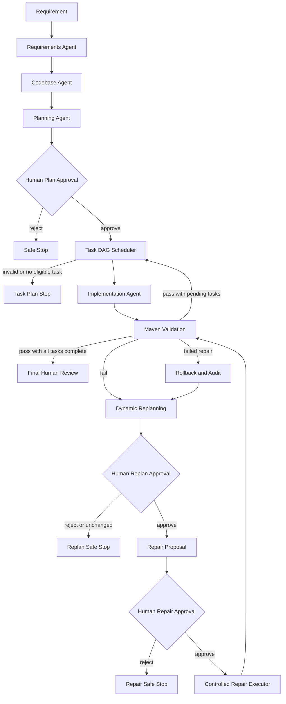
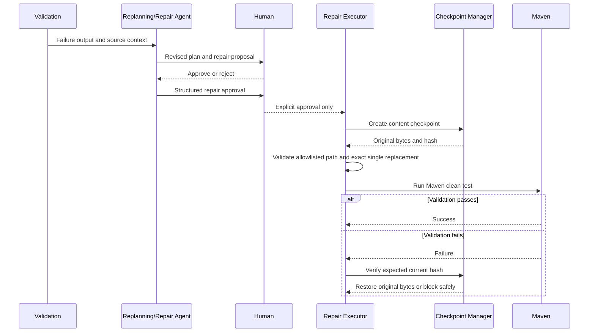

# Agentic SDLC Architecture

This document describes the behavior implemented in the repository. It is deliberately narrower than a proposal: capabilities that are not implemented, such as arbitrary autonomous shell execution, are identified as limitations.

## Components and responsibilities

### Java URL shortener

- `UrlController` accepts HTTPS URL creation requests and optional `expiresAt` timestamps, and exposes analytics.
- `UrlService` generates unique short codes, rejects non-future expiration timestamps, saves entities, increments clicks for active redirects, and returns 404/410 errors for unknown/expired codes.
- `ShortUrl` is the JPA entity containing the original URL, short code, click count, creation time, and optional expiration.
- `RedirectController` returns HTTP 302 for active short codes.
- `UrlRepository` provides JPA persistence and short-code lookup.

### Python agents and orchestrators

| Agent or module | Implemented responsibility |
| --- | --- |
| Requirements Agent | Uses Ollama to analyze functional/nonfunctional requirements, acceptance criteria, ambiguity, and risks. |
| Codebase Agent | Reads Java files under `url-shortener/src/main/java` and asks Ollama for an evidence-based architecture analysis. |
| Planning Agent | Uses requirements and codebase analysis to produce an implementation plan and converts strict JSON task lists into task state. |
| Human approval node | Interrupts the graph and accepts `approve` or `reject`. |
| Task scheduler | Validates task fields and dependencies, detects cycles/missing IDs/duplicates, marks eligible tasks, and reports independent nonoverlapping batches. |
| Parallel DAG Orchestrator | Partitions task DAGs into topological waves, fans out concurrent independent workers, enforces level synchronization, and executes whole-set transactional rollback on failure. |
| Implementation Agent | Requires approval and writes only the isolated `ShortUrl.java` target; it skips generation if expiration support already exists. |
| Validation Agent | Runs `./mvnw clean test` in the isolated workflow worktree and returns pass/fail, exit code, duration, and bounded output. |
| Repair Agent | Analyzes bounded Maven output against the isolated Java source and returns a proposal. It does not modify files or execute commands. |
| Replanning Agent | Produces strict JSON containing a revised plan and change summary using requirement, current plan, failure metadata/output, and retry history. |
| Repair Executor | Applies only an approved exact `old_text` → `new_text` replacement in the allowlisted Java file after checkpointing. |
| Rollback Manager | Creates and verifies content-hash checkpoints and restores only when the current file hash matches the expected post-change hash. |
| Audit Logger | Persists structured event metadata in SQLite. |

## LangGraph workflow

### High-level system architecture

```mermaid
flowchart LR
    Source[Java source tree] --> Codebase[Codebase Agent]

    subgraph Application[Spring Boot 4 URL Shortener]
        API[REST controllers]
        Service[UrlService]
        Store[(H2 via JPA)]
        API --> Service --> Store
    end

    subgraph Orchestrator[Python LangGraph Orchestrator]
        Analysis[Requirements, codebase, planning, replanning]
        Approval[Human approval interrupts]
        Tasks[Dependency-aware scheduler]
        Repair[Controlled repair executor]
        Audit[(SQLite audit.db)]
        Checkpoints[(SQLite workflow.db)]
        Analysis --> Approval --> Tasks --> Repair
        Approval --> Audit
        Tasks --> Audit
        Repair --> Audit
        Orchestrator -. checkpoint state .-> Checkpoints
    end

    Model[Ollama qwen2.5-coder:latest] --> Analysis
    Codebase --> Analysis
    Repair --> Worktree[Isolated workflow worktree]
    Worktree --> Maven[Maven Wrapper validation]
    Maven --> Orchestrator
```

### End-to-end workflow



`MAX_RETRIES` is two. A failed validation does not loop indefinitely: it either enters the bounded replanning/repair path, reaches failure after the retry limit, or stops when a plan is unchanged, rejected, invalid, or unsafe to roll back.

## Dependency-aware multi-wave parallel DAG execution

Tasks specify strict schema fields, dependency lists, and allowlisted target paths:

```json
{
  "task_id": "implementation",
  "description": "Execute the approved implementation plan",
  "dependencies": [],
  "status": "PENDING",
  "allowed_files": ["url-shortener/src/main/java/url_shortener/ShortUrl.java"]
}
```

### DAG validation and topological wave partitioning

The DAG scheduler (`agent-orchestrator/governance/task_orchestrator.py`):

1. Rejects malformed tasks, duplicate IDs, missing dependencies, invalid file paths, and cycles.
2. Partitions acyclic tasks into ordered topological execution waves via `topological_execution_waves(tasks)`.
3. Ensures that all tasks within a wave have zero mutual dependencies and strictly disjoint `allowed_files` sets to eliminate uncoordinated write hazards.
4. Preserves deterministic task ordering across waves.

### Parallel dispatch and level synchronization

The multi-wave orchestrator (`agent-orchestrator/governance/parallel_execution.py`) executes task DAGs across distinct synchronization levels:

```
[Wave 0: Independent Tasks] ─── (Level Barrier & Validation) ───► [Wave 1: Dependent Tasks] ───► ...
  ├── Worker Task A (file1)           ✓ Maven validation                ├── Worker Task C (file3)
  └── Worker Task B (file2)           ✓ Transactions marked validated   └── Worker Task D (file4)
```

1. **Dynamic fan-out (`Send`):** Tasks in wave $k$ are dispatched concurrently to worker nodes up to `max_concurrency` worker limits.
2. **Superstep level synchronization:** LangGraph superstep boundaries barrier-synchronize all workers in wave $k$. No downstream task in wave $k+1$ is dispatched until all tasks in wave $k$ complete and the combined wave passes Maven validation.
3. **Predecessor output consumption:** Tasks in subsequent waves execute directly against the verified, applied source outputs generated by predecessor waves.
4. **Durable checkpoints and wave resumption:** State records `executed_waves` and task receipts. Resumed workflows bypass previously validated waves and advance directly to uncompleted waves without re-executing completed work.

### Whole-set rollback guarantees and recovery

Each task transaction is managed through `file_transaction.py`:

- **Per-wave validation:** Following successful worker execution, wave changes are validated as a unified set. On passing validation, the wave's transactions transition to `'validated'`.
- **Whole-set rollback across waves:** If a task in any wave fails, or if wave validation fails, the orchestrator triggers whole-set rollback: all transactions from the failed wave and all previously validated predecessor waves are rolled back in reverse topological order (`finish_transaction(..., passed=False)`), restoring the repository to its baseline state prior to wave 0.
- **External tamper protection:** Rollback preflights every file against `expected_current_hash` and `original_hash`. If an external process modifies an edited file before rollback, the transaction manager blocks safe restore and transitions the workflow to `STOPPED_PARALLEL_RECOVERY_REQUIRED` rather than overwriting external edits.

### Remaining limitations

1. **Disjoint file sets per wave:** Multiple concurrent workers cannot write to the same file in the same wave. Shared-file edits must be scheduled across separate dependent waves.
2. **Production Java scope:** Task paths remain constrained to allowlisted production Java source files.
3. **Bounded attempts:** Each individual task execution is subject to bounded attempt budgets without unbounded retry loops.

## Dynamic replanning

When validation fails and retries remain, the replanning node sends the following context to Ollama:

- Original requirement.
- Current plan.
- Validation pass/fail, exit code, duration, and bounded failure output.
- Replanning/retry history.

The model must return JSON with `revised_plan` and `change_summary`. The plan receives a new version and is compared after whitespace normalization. An unchanged plan is audited and stopped without another execution. A changed plan pauses for human approval before the existing repair proposal and repair approval stages.

## Repair approval and rollback



The executor accepts no commands, patch language, or arbitrary file list. It rejects absolute paths, traversal, symlink escapes, unsupported fields, and replacements whose expected text does not occur exactly once. The rollback manager separately verifies checkpoint integrity and refuses to restore a file that changed unexpectedly.

## Checkpointing and audit logging

- LangGraph uses `SqliteSaver.from_conn_string("workflow.db")` to persist resumable graph checkpoints by workflow/thread ID.
- `governance.audit_logger.log_event` writes UTC timestamps, workflow ID, agent, event, and JSON metadata to `agent-orchestrator/audit.db`.
- Audit metadata intentionally excludes API keys, full source code, and complete Maven logs.
- Representative events include `PLAN_APPROVED`, `PLAN_REJECTED`, `TASKS_SCHEDULED`, `TASKS_STARTED`, `TASKS_COMPLETED`, `VALIDATION_PASSED`, `VALIDATION_FAILED`, `REPLAN_GENERATED`, `REPLAN_APPROVED`, `REPLAN_REJECTED`, `REPAIR_EXECUTED`, `REPAIR_ROLLBACK_COMPLETED`, and `REPAIR_ROLLBACK_BLOCKED`.

## Test interpretation

The deterministic Python tests mock model responses, Maven validation, file writes, and rollback calls. They verify control flow and safety properties; they are not evidence that Ollama itself generated a correct repair or that every external environment is configured. The Java integration tests run the real Spring Boot application context, MockMvc, JPA repository, and H2-backed behavior through Maven.
